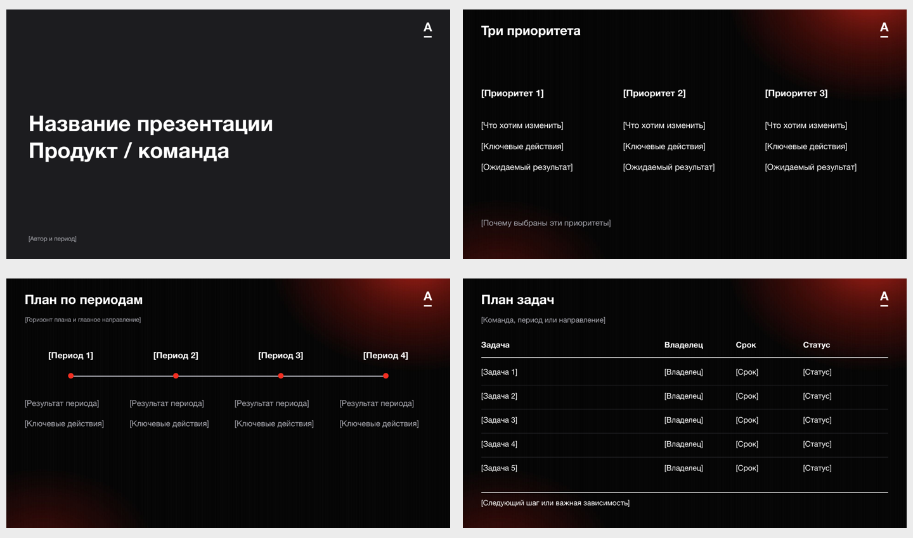

# Skills

Коллекция переиспользуемых навыков для Codex и Claude Code. Каждый навык содержит инструкции и необходимые ресурсы; материалы конкретных задач хранятся отдельно.

## Навыки

| Навык | Назначение |
|---|---|
| [Alfa Presentation Studio](skills/alfa-presentation-studio/SKILL.md) | Подготовка презентаций в стиле Альфы: обсуждение задачи, история и тексты, дизайн, подагенты и проверка итоговых слайдов |



## Быстрый старт

Клонируйте репозиторий:

```bash
git clone https://github.com/marcusaure1ius/skills.git
```

Откройте папку в Codex или Claude Code и напишите:

> Прочитай `skills/alfa-presentation-studio/SKILL.md` и используй этот навык. Хочу подготовить презентацию о плане продукта на следующий год. Помоги определить главную мысль, предложи структуру и понятные тексты, задавай необходимые вопросы. Используй приложенный шаблон. Итоговый формат — PPTX.

Для этого установка не нужна. В новой беседе снова укажите путь к SKILL.md. Можно дать полное задание и сразу попросить готовый результат либо начать с обсуждения содержания. Для клонирования приватного репозитория нужен доступ к нему.

## Постоянная установка

Скопируйте папку нужного навыка из `skills/` в каталог своего клиента:

| Клиент | Каталог | Вызов Alfa Presentation Studio в новой сессии |
|---|---|---|
| Текущий настольный Codex | `~/.codex/skills/` | `$alfa-presentation-studio` |
| Codex CLI | `~/.agents/skills/` | `$alfa-presentation-studio` |
| Claude Code | `~/.claude/skills/` | `/alfa-presentation-studio` |

Пути могут отличаться в другом клиенте или нестандартной конфигурации. Если одноимённый навык уже установлен, сохраните его изменения перед обновлением и используйте одну актуальную версию. Не создавайте две независимые установки в каталогах, которые клиент одновременно читает.

Репозиторий — источник общих инструкций и шаблонов. После изменения обновляйте установленные копии; работа напрямую из репозитория использует текущие файлы. Установка не переносит ключи, подключения или разрешения.

## Структура

```text
.
├── README.md
├── .gitignore
├── .codex/
│   └── agents/alfa-slide-humanizer.toml
└── skills/
    └── alfa-presentation-studio/
        ├── SKILL.md
        ├── references/
        │   ├── design.md
        │   ├── roles.md
        │   ├── roles/humanizer.md
        │   └── humanizer/SKILL.md
        └── assets/
            ├── template.pptx
            └── preview.png
```

Новый навык добавляется отдельной папкой `skills/<название>/` с входным файлом `SKILL.md`; после добавления обновите таблицу выше. Дополнительные файлы включайте, если они нужны для работы навыка.

## Alfa Presentation Studio

Основной агент ведёт диалог, помогает с содержанием и подключает редактора, отдельного Humanizer, дизайнера и проверяющего. Humanizer обрабатывает текст после редактора и перед сборкой, сохраняя факты, названия и статус решений. Инструкции ролей входят в `references/roles.md`; отдельная установка профилей не требуется. Если подагенты недоступны, роли выполняются последовательно.

В `.codex/agents/alfa-slide-humanizer.toml` находится нативный профиль Humanizer для работы из этого репозитория. Если клиент его не загрузил, координатор передаёт обычному подагенту `references/roles/humanizer.md` и встроенный `references/humanizer/SKILL.md`. Модели и разрешения профиль не переопределяет.

Из [blader/humanizer](https://github.com/blader/humanizer/blob/main/SKILL.md) включён только исходный `SKILL.md`, без остальных файлов репозитория. Его версия и лицензия MIT сохранены в YAML; обновление копии выполняется по отдельному запросу.

В `assets/template.pptx` находятся 12 редактируемых композиций. Это библиотека, а не обязательный порядок или объём презентации. Продуктовый план, стратегия, статус работ и исследование могут иметь разные истории. Факты и планы берутся из новых материалов; содержание не придумывается ради заполнения шаблона.

Процесс меняется в `SKILL.md`, оформление и язык — в `references/design.md`, ответственность ролей — в `references/roles.md`. После изменения PPTX обновите общее превью.

Для сборки и просмотра итоговых слайдов используются инструменты клиента. Для Google Slides нужно собственное авторизованное подключение и средства импорта либо сборки; локальный PPTX входит в репозиторий. Если инструментов нет, агент обозначает конкретное ограничение. Подготовленный текст или изображения не выдаются за готовую редактируемую презентацию.

Пакет рассчитан на Codex и Claude Code. В других чатах можно передать инструкции и шаблон как материалы, но установка, подагенты и создание файлов зависят от клиента. Оформление основано на пользовательском шаблоне Альфы и не заменяет официальный полный брендбук.

Материалы конкретных презентаций храните отдельно от навыка. Папки `work/` и `outputs/` исключены из Git. Доступ к личному Google-диску автора не требуется.
